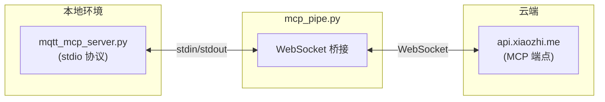

# 小智 ESP32 AI硬件编程教案：RGB彩灯控制与MQTT消息收发

## 一、课程简介

本教案通过在"小智 ESP32"大模型语音助手中加入 **RGB全彩LED灯** 模块，引导学生理解**大语言模型如何通过MCP协议发送和接收MQTT消息**，同时学习GPIO输出控制、PWM调光原理及MQTT物联网通信基础。

---

## 二、项目核心功能

1. **AI语音自然交互**：通过网络与云端大模型通话，用自然语言对设备发号施令。
2. **本地RGB彩灯控制**：利用ESP32的PWM输出功能，小智可以用不同颜色表达情绪或状态。
3. **大模型自主逻辑决策（MCP）**：无需硬编码规则，告诉AI任何规则，大模型自动判断何时改变灯光。
4. **MQTT消息收发能力**：通过MCP协议，主动将设备状态发布到指定Topic，实现与其他IoT设备的联动。
5. **远程设备状态订阅**：订阅MQTT服务器上的特定Topic，接收来自其他设备或平台（如HomeAssistant）的控制指令。

---

## 三、硬件接线准备

### 3.1 RGB LED 引脚说明

本课程使用 **普通RGB LED（共阳极，4根引脚）**，通过PWM调光实现1677万种颜色混色效果。

| 颜色通道 | GPIO编号 | 说明 |
|---------|---------|------|
| 红色 R   | GPIO 10 | PWM输出 |
| 绿色 G   | GPIO 11 | PWM输出 |
| 蓝色 B   | GPIO 12 | PWM输出 |
| 共阳极   | 3.3V    | 电源正极 |

> **原理提示**: 共阳极RGB LED的公共端接正极，三个颜色通道通过拉低对应的GPIO来点亮。通过PWM快速切换，可以控制每个颜色的亮度（0-255级）。

**接线示意图：**

```
ESP32                    RGB LED（共阳极）
GPIO 10 ────[220Ω]────── R
GPIO 11 ────[220Ω]────── G
GPIO 12 ────[220Ω]────── B
3.3V   ───────────────── + (共阳)
GND    ───────────────── 地线
```

---

## 四、核心代码讲解

### 4.1 RGB LED驱动原理 (PWM调光)

ESP32内置LEDC (LED Controller) 硬件模块，可自动产生PWM信号，无需CPU干预。

**RGB LED驱动结构体：**

```c
typedef struct {
    gpio_num_t gpio_r, gpio_g, gpio_b;  // GPIO引脚
    ledc_channel_config_t channel_r, channel_g, channel_b;  // PWM通道
} rgb_led_t;

// 初始化PWM输出
ledc_timer_config_t timer = {
    .speed_mode = LEDC_LOW_SPEED_MODE,
    .timer_num = LEDC_TIMER_0,
    .duty_resolution = LEDC_TIMER_13_BIT,  // 13位分辨率 (0-8191)
    .freq_hz = 1000,                       // 1kHz刷新率
};

// 配置三个PWM通道
ledc_channel_config_t channels[] = {
    { .gpio_num = GPIO_NUM_10, .channel = LEDC_CHANNEL_0, ... },
    { .gpio_num = GPIO_NUM_11, .channel = LEDC_CHANNEL_1, ... },
    { .gpio_num = GPIO_NUM_12, .channel = LEDC_CHANNEL_2, ... }
};

// 设置RGB颜色 (0-255范围)
void rgb_led_set_color(rgb_led_t *led, uint8_t r, uint8_t g, uint8_t b) {
    uint32_t max_duty = 8191;  // 13位最大值
    ledc_set_duty(LEDC_CHANNEL_0, max_duty - (r * 32));
    ledc_set_duty(LEDC_CHANNEL_1, max_duty - (g * 32));
    ledc_set_duty(LEDC_CHANNEL_2, max_duty - (b * 32));
    ledc_update_duty(...);  // 更新三个通道
}
```

### 4.2 MCP工具注册

大语言模型不知道你插了RGB灯，需要将灯包装成**工具(Tool)**，并使用描述告诉AI这个工具能干什么。

**MCP工具注册示例（C++）：**

```cpp
mcp_server.AddTool(
    "self.device.set_rgb_color",
    "Control the RGB LED to display a specific color. "
    "Parameters: r, g, b values range from 0 to 255. "
    "Examples: (255,0,0)=red, (0,255,0)=green, (0,0,255)=blue.",
    PropertyList({
        Property("r", kPropertyTypeInteger, 0, 255, "Red intensity"),
        Property("g", kPropertyTypeInteger, 0, 255, "Green intensity"),
        Property("b", kPropertyTypeInteger, 0, 255, "Blue intensity")
    }),
    [](const PropertyList& properties) -> ReturnValue {
        int r = properties["r"].value<int>();
        int g = properties["g"].value<int>();
        int b = properties["b"].value<int>();
        rgb_led_set_color(&g_rgb_led, r, g, b);  // 调用PWM函数
        return true;
    }
);
```

**MQTT相关MCP工具（详见第六节）：**

| 工具名 | 功能 |
|--------|------|
| `self.mqtt.publish` | 向指定主题发布消息 |
| `self.mqtt.subscribe` | 订阅MQTT主题 |
| `self.mqtt.unsubscribe` | 取消订阅 |
| `self.mqtt.get_messages` | 获取消息历史 |
| `self.mqtt.get_status` | 查询连接状态 |

---

## 五、MCP与MQTT协议流程

### 5.1 MCP协议消息格式（JSON-RPC 2.0）

MCP（Model Context Protocol）是一种基于JSON-RPC 2.0的通信协议，所有消息都遵循以下格式：

```json
{
  "session_id": "abc123",
  "type": "mcp",
  "payload": {
    "jsonrpc": "2.0",
    "method": "tools/call",
    "params": {
      "name": "self.mqtt.publish",
      "arguments": {
        "topic": "home/lights",
        "message": "{\"color\":\"red\"}"
      }
    },
    "id": 42
  }
}
```

### 5.2 工具调用完整流程

| 阶段 | 发起方 | 说明 |
|------|--------|------|
| 1. 初始化 | MCP Client → Server | 建立连接，返回设备信息和协议版本 |
| 2. 发现工具 | MCP Client → Server | 获取可用工具列表 |
| 3. 调用工具 | MCP Client → Server | 云端大模型决策后发起调用 |
| 4. 执行操作 | MCP Server | 设备端调用GPIO、PWM等底层函数 |
| 5. 返回结果 | MCP Server → Client | 返回执行结果，云端大模型生成回复 |

### 5.3 MQTT消息交互示例

**发布消息：**

```json
{
  "payload": {
    "method": "tools/call",
    "params": {
      "name": "self.mqtt.publish",
      "arguments": {
        "topic": "xiaozhi/status",
        "message": "{\"temperature\":25,\"humidity\":60}",
        "retain": true
      }
    }
  }
}
```

**订阅主题：**

```json
{
  "payload": {
    "method": "tools/call",
    "params": {
      "name": "self.mqtt.subscribe",
      "arguments": { "topic": "home/+/lights/#", "qos": 1 }
    }
  }
}
```

---

## 六、MCP服务接入与启动流程

### 6.1 系统架构

小智设备通过 `mcp_pipe.py` 建立的 WebSocket 隧道，将本地的 MCP 服务器（通过 stdio 协议通信）桥接到云端 MCP 端点：



**关键组件：**
- **MCP 端点**：`wss://api.xiaozhi.me/mcp/?token=<JWT_TOKEN>`
- **mcp_pipe.py**：WebSocket 与 stdio 之间的数据管道，负责消息双向转发，支持自动重连
- **mqtt_mcp_server.py**：本地 MCP 服务器，通过标准 stdio 与 mcp_pipe.py 通信
- **mcp_config.json**：MCP 服务器配置文件

### 6.2 配置文件

`mcp_config.json` 定义了本地 MCP 服务器的启动方式：

```json
{
  "mcpServers": {
    "mqtt_control": {
      "type": "stdio",
      "command": "python",
      "args": ["mqtt_mcp_server.py"],
      "env": { "PYTHONIOENCODING": "utf-8" },
      "disabled": false
    }
  }
}
```

### 6.3 启动脚本

运行 `start_mcp.bat` 自动完成：虚拟环境激活 → 环境变量设置 → 调用 `mcp_pipe.py` 建立连接。

```bat
@echo off
chcp 65001 >nul
cd /d "%~dp0"

:: 激活虚拟环境并安装依赖
if exist "venv\Scripts\activate.bat" (
    call venv\Scripts\activate.bat
) else (
    python -m venv venv
    call venv\Scripts\activate.bat
    pip install -q -r requirements.txt
)

:: 设置MCP端点（未设置时使用默认值）
if not defined MCP_ENDPOINT (
    set "MCP_ENDPOINT=wss://api.xiaozhi.me/mcp/?token=<JWT_TOKEN>"
)

:: 启动服务
python mcp_pipe.py
```

### 6.4 mqtt_mcp_server.py 核心实现

`mqtt_mcp_server.py` 是基于 FastMCP 框架的本地 MCP 服务器，负责与 MQTT Broker 的连接管理。

**依赖项（requirements.txt）：**

```txt
mcp >= 1.8.1
fastmcp >= 0.1.0
paho-mqtt >= 2.0.0
websockets >= 11.0.3
```

**MQTT 配置与回调：**

```python
MQTT_BROKER = "47.97.8.221"
MQTT_PORT = 1883

def on_mqtt_connect(client, userdata, flags, rc, properties=None):
    if rc == 0:
        device_status['mqtt_connected'] = True
        client.subscribe(TOPICS['status'])
        client.subscribe(TOPICS['response'])

def on_mqtt_message(client, userdata, msg):
    payload = msg.payload.decode('utf-8', errors='ignore')
    if msg.topic == TOPICS['response']:
        response_messages.append(json.loads(payload))
```

**MCP 工具注册（FastMCP 装饰器方式）：**

```python
from mcp.server.fastmcp import FastMCP
mcp = FastMCP("MQTT Controller")

@mcp.tool()
def publish_mqtt(topic: str, message: str, qos: int = 1, retain: bool = False) -> dict:
    """向指定的 MQTT topic 发布消息"""
    payload = json.dumps({'message': message, 'timestamp': time.strftime('%Y-%m-%d %H:%M:%S')})
    result = mqtt_client.publish(topic, payload, qos=qos)
    return {"success": result.rc == mqtt.MQTT_ERR_SUCCESS, "topic": topic}

@mcp.tool()
def subscribe_mqtt(topic: str, qos: int = 1) -> dict:
    """订阅 MQTT topic（支持通配符: + 单级, # 多级）"""
    mqtt_client.subscribe(topic, qos)
    return {"success": True, "topic": topic}

@mcp.tool()
def get_mqtt_messages(topic_filter: str = "", count: int = 10) -> dict:
    """获取最近收到的 MQTT 消息"""
    return {"success": True, "messages": response_messages[-count:]}

@mcp.tool()
def get_mqtt_status() -> dict:
    """获取 MQTT 连接状态和设备状态"""
    return {"success": True, "mqtt_connected": device_status['mqtt_connected'],
            "devices": device_status.copy()}

if __name__ == "__main__":
    init_mqtt()
    mcp.run(transport="stdio")  # 使用 stdio 传输协议运行
```

---

## 七、提示词参考

以下是用于与大模型交互时，控制设备与 MQTT 功能的提示词示例。

**可用工具一览：**

| 类别 | 工具名 | 功能 |
|------|--------|------|
| 设备控制 | `light_on` / `light_off` / `light_control` | 电灯开关及亮度调节 |
| 设备控制 | `led_control` | LED 灯控制 |
| 设备控制 | `control_fan` | 风扇控制 |
| MQTT | `publish_mqtt` | 向指定主题发布消息 |
| MQTT | `subscribe_mqtt` | 订阅主题 |
| MQTT | `unsubscribe_mqtt` | 取消订阅 |
| MQTT | `get_mqtt_messages` | 获取收到的消息 |
| MQTT | `get_mqtt_status` | 查询连接状态 |
| 系统 | `control_multiple_devices` | 批量控制多个设备 |
| 系统 | `clear_messages` | 清空消息记录 |

### 7.1 设备控制提示词

| 使用场景 | 提示词示例 |
|---------|-----------|
| 开灯 | "小智，开灯" |
| 关灯 | "小智，关灯" |
| 调节亮度 | "小智，把灯调暗一点" |
| 风扇开关 | "小智，开风扇" / "小智，关风扇" |
| 风扇调速 | "小智，把风扇调快一点" |
| 批量控制 | "小智，开灯并打开风扇" |

### 7.2 MQTT 消息发布提示词

| 使用场景 | 提示词示例 |
|---------|-----------|
| 报告状态 | "小智，向 home/status 报告一下当前状态" |
| 发送消息 | "小智，帮我发送消息到 sensor/temperature" |
| 发送通知 | "小智，通知智能家居灯已打开" |

### 7.3 MQTT 消息订阅提示词

| 使用场景 | 提示词示例 |
|---------|-----------|
| 订阅主题 | "小智，帮我订阅 home/light/control 主题" |
| 订阅通配符 | "小智，订阅一下所有传感器的主题" |
| 查看消息 | "小智，帮我看看收到了哪些 MQTT 消息" |
| 取消订阅 | "小智，取消订阅 test/topic" |

### 7.4 查询提示词

| 使用场景 | 提示词示例 |
|---------|-----------|
| 查询MQTT状态 | "小智，MQTT 连接正常吗？" |
| 查询设备状态 | "小智，现在开了哪些设备？" |
| 清空消息 | "小智，清空消息历史" |

### 7.5 提示词设计原则

1. **自然语言优先**：使用日常用语，如"把灯调亮一些"
2. **包含明确动作**：使用"开"、"关"、"发送"、"订阅"等动词
3. **渐进式复杂度**：从简单单步操作开始，逐步引入多步骤联动场景

> **提示**：以上提示词示例仅供参考，实际使用时 AI 会根据工具描述（Tool Description）自行判断调用哪些工具。

---

## 八、参考资料

- 小智ESP32官方仓库：https://github.com/78/xiaozhi-esp32
- MCP协议官方文档：https://modelcontextprotocol.io/specification/2024-11-05
- ESP-IDF LEDC驱动文档：https://docs.espressif.com/projects/esp-idf/zh_CN/latest/esp32/api-reference/peripherals/ledc.html
- MQTT协议v3.1.1规范：https://docs.oasis-open.org/mqtt/mqtt/v3.1.1/mqtt-v3.1.1.html
- FastMCP 框架：https://github.com/jlowin/fastmcp
- Paho MQTT Python客户端：https://eclipse.dev/paho/index.php?page=clients/python/index.php
